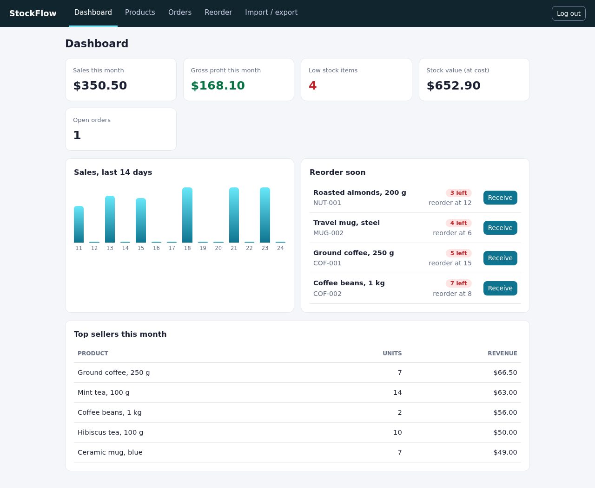
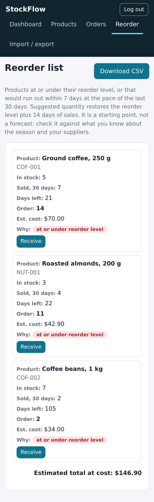
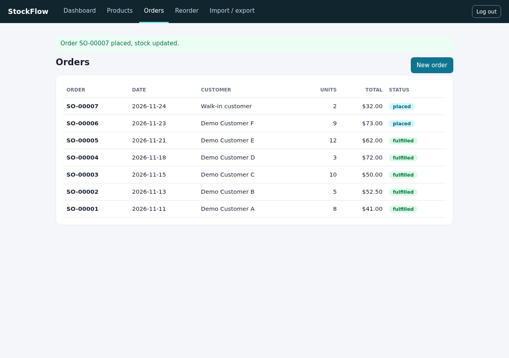

# StockFlow

Inventory, orders and sales reports for small shops. Local demo project. Demo products and customers are fictional.

_Screenshots of the running app with fictional demo data (captured from the real app in Chrome)._

## Run
Needs Node 22 or newer. No packages to install.

    npm start                  # http://127.0.0.1:3200
    SEED_DEMO=1 npm start      # same, plus a fictional demo shop on a brand-new database
    npm test                   # 21 automated tests
    node docs/e2e.js           # real server + real Chrome run with a restart (needs google-chrome)

First run: open the page and create your account (username, password of at least 10 characters). That form only works while no account exists. There are no default credentials.
Environment: `PORT` (3200), `HOST` (127.0.0.1, local only), `DB` (stock.db), `SHOP_TZ` (Africa/Cairo) and `CURRENCY` (USD), both read when the database is first created.

## What it does
- Products: SKU, name, price, cost, reorder level, active flag, opening stock. Stock is never typed in directly: it is the sum of recorded movements (opening, purchase, sale, return, adjustment, import), so every number can be traced.
- Receive stock, and correct a stock count (the difference is recorded with a required reason).
- Orders: pick products and quantities; stock is checked for the whole order first and nothing is saved if any line is short. Order lines keep the price and cost at the time of sale. Fulfil an order, or cancel a placed order to return its stock exactly once.
- Dashboard: sales and gross profit this month, low-stock list with one-click receive, stock value at cost, open orders, 14-day sales chart, top sellers. Cancelled orders are excluded.
- Reorder list: products at or under their reorder level, or that would run out within 7 days at the last 30 days' pace, with a suggested order quantity (reorder level plus 14 days of sales), estimated cost at your saved cost, and CSV download. A starting point, not a forecast.
- Stock history per product with a running balance; printable packing slip per order.
- CSV: import products with a check step first (columns sku, name, price, optional cost, reorder_level, stock). Any bad row blocks the whole import and the problem lines are listed. Export products and the full movement log. Exports neutralise spreadsheet formulas.
Simultaneous orders for the last units cannot oversell (tested).

## Limits
Not security-reviewed; serve over HTTPS before real use (session cookie is not Secure). One user role, no password reset, no barcode scanning, no suppliers or purchase orders, no variants, no tax, no multi-location stock, no returns of individual items from fulfilled orders. One currency per database. Rate limits are in memory per process. Gross profit uses the cost saved on each order line, so it is only as good as the costs you enter.

## Browser demo
`demo/` is a browser-only demo build: it runs this app's own `core.js` and `server.js` request handler inside the page, with SQLite compiled to WebAssembly ([sql.js](https://github.com/sql-js/sql.js)). Nothing is sent to a server. Each visitor gets their own fictional data, stored in that browser's localStorage, with a "Reset demo data" button. The demo signs in automatically with a built-in demo user and uses a stand-in for password hashing, so it is not a model of the real app's login. Serve the `demo/` folder from any static host. Rebuild it with `node tools/demo-build/build.js` (see the header of that file for arguments).

## Hosting for real use
Serve it behind HTTPS and set `COOKIE_SECURE=1` so the session cookie is marked Secure. Responses send `X-Frame-Options: DENY` and `Referrer-Policy: no-referrer`. Do not expose a fresh database to the internet: the first visitor to open the setup page becomes the owner.
